<a href="https://impiyushkumar.github.io/"><picture>
  <source media="(prefers-color-scheme: dark)" srcset="https://readme-typing-svg.demolab.com?font=Hanken+Grotesk&weight=600&size=26&duration=2800&pause=900&color=ECEEF3&center=true&vCenter=true&width=560&height=50&lines=hi%2C+I'm+Piyush+%F0%9F%91%8B;I+ship+from+code+to+cloud+%E2%98%81%EF%B8%8F;I+build+AI+that+listens%2C+speaks+%26+reads;currently+keeping+servers+alive">
  
</picture></a>

Software Engineer · Cloud & AI/ML · Data · Mumbai

[Portfolio](https://impiyushkumar.github.io/) · [LinkedIn](https://www.linkedin.com/in/impiyushkumar0/) · [X](https://x.com/pydatawiz) · [Email](mailto:piyushkumar5435@gmail.com) · [Resume](https://impiyushkumar.github.io/resume/Piyush_Kumar_Resume.pdf)

**Now:** Cloud & AI Automation Engineer at [EnglishJobsGermany](https://englishjobsgermany.com/), where I run the servers, migrated the platform from AWS to GCP, and build AI automations.

### Things I've built

| | Project | What it does |
|---|---|---|
| 🧭 | **[JobMesh](https://jobmesh.in/)** | Aggregates 4,000+ tech jobs from 200+ companies, LLM-tagged, with an admin dashboard and technical SEO |
| 🎙️ | **[PronounceAI](https://github.com/impiyushkumar/PronounceAI)** | Listens to you speak, scores every word with Whisper + phonemes, and Gemini tells you what to fix |
| 📄 | **[VedaAI](https://vedaai-tool.vercel.app/)** | Reads handwritten answer sheets and maps each answer to its question with bounding boxes |
| 🔊 | **[Multilingual TTS](https://github.com/impiyushkumar/infinia-tts-pipeline)** | Voice-cloning TTS in English, Hindi and Arabic, benchmarked at 0.018 real-time factor |

<b>Stack</b> (click)

 

**Cloud & DevOps** · GCP · AWS EC2/S3 · Docker · Nginx · PM2 · Linux · CI/CD
**AI** · Gemini · Whisper · XTTS-v2 · MMS-TTS · prompt engineering · model evaluation
**Web** · TypeScript · React · Next.js · Node.js · Express · FastAPI
**Data** · Python · SQL · Pandas · Power BI · MongoDB · MySQL

 

<picture>
  <source media="(prefers-color-scheme: dark)" srcset="https://raw.githubusercontent.com/impiyushkumar/impiyushkumar/output/snake-dark.svg">
  
</picture>

press ⌘K on my <a href="https://impiyushkumar.github.io/">portfolio</a> · click the little guy, he jumps

